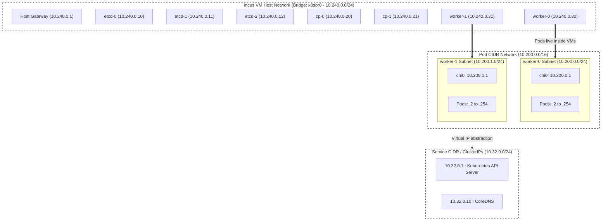

# Part 1: Control Plane & Cluster Bootstrap from Scratch

In this part, we get familiar with the core Kubernetes components and bootstrap an HA etcd cluster, control plane, and worker nodes using Incus KVM virtual machines and cloud-init.

> **Note**: Commands in this guide assume your working directory is `part_1/` unless specified otherwise.

---

## 1. Cloud-Init Bootstrapping

- We use **cloud-init** instead of external configuration management tools (like Ansible) to provision each VM automatically at boot time.
- Separate cloud-init configurations are provided for:
  - etcd nodes: [`cloudinit/user-data-etcd.yaml`](cloudinit/user-data-etcd.yaml)
  - Control plane nodes: [`cloudinit/user-data-control-plane.yaml`](cloudinit/user-data-control-plane.yaml)
  - Worker nodes: [`cloudinit/user-data-worker-nodes.yaml`](cloudinit/user-data-worker-nodes.yaml)
- **Why?** This enables reproducible and rapid teardown/recreation of any VM if you run into configuration issues or want to rebuild from scratch.

---

## 2. Sourcing Binaries & Local HTTP Server

To keep VM provisioning fast and offline-capable:
1. Download all required binaries to your host machine once by running the fetch scripts inside `part_1`:
   ```bash
   ./fetch_k8s_binaries.sh
   ./fetch_worker_binaries.sh
   ```
2. Serve the cached binaries and PKI files to the VMs via Python's built-in HTTP server:
   ```bash
   python3 -m http.server 8080 --bind 0.0.0.0 -d .
   ```
   *(The `-d .` flag sets the document root so VM curl commands can fetch from `http://10.240.0.1:8080/binaries/` and `http://10.240.0.1:8080/pki/`).*

---

## 3. Incus Networking & VM Profiles

All VMs run on a single Incus bridge network (`k8sbr0`) so they can communicate over a private L2/L3 subnet.



### Create the Incus Network Bridge:
```bash
incus network create k8sbr0 ipv4.address=10.240.0.1/24 ipv4.nat=true ipv6.address=none dns.domain=k8s.local
```

### Create the VM Profiles:
Profiles define VM resource sizing (vCPU, RAM, disk) and are located in [`vm-profiles/`](vm-profiles/):
```bash
incus profile create k8s-etcd < ./vm-profiles/k8s-etcd.yaml
incus profile create k8s-control-plane < ./vm-profiles/k8s-control-plane.yaml
incus profile create k8s-worker < ./vm-profiles/k8s-worker.yaml
```

### Attach Cloud-Init User Data to Each Profile:
```bash
incus profile set k8s-etcd cloud-init.user-data - < ./cloudinit/user-data-etcd.yaml
incus profile set k8s-control-plane cloud-init.user-data - < ./cloudinit/user-data-control-plane.yaml
incus profile set k8s-worker cloud-init.user-data - < ./cloudinit/user-data-worker-nodes.yaml
```
*(Re-run the respective `incus profile set ...` command whenever you update a cloud-init YAML file).*

---

## 4. PKI & Certificate Generation

We use **cfssl** to generate all cluster certificates. Run these commands from the `pki` directory:

```bash
cd pki

# 1. Initialize and self-sign the cluster Root CA
cfssl gencert -initca ./root-ca/ca-csr.json | cfssljson -bare ./root-ca/root-ca

# 2. Generate all component certificates (etcd, apiserver, scheduler, controller-manager, workers)
bash gencert.sh
```

- To wipe and regenerate certificates if needed: run `bash del-cert.sh`.
- Review [`pki/readme.md`](pki/readme.md) for the complete breakdown of every certificate, SAN, and the mandatory `CN`/`O` mappings.

---

## 5. Bootstrapping the etcd Cluster

Launch the 3-node HA etcd cluster as genuine KVM virtual machines (`--vm`):

```bash
incus launch images:debian/bookworm/cloud etcd-0 --profile k8s-etcd --device eth0,ipv4.address=10.240.0.10 --vm
incus launch images:debian/bookworm/cloud etcd-1 --profile k8s-etcd --device eth0,ipv4.address=10.240.0.11 --vm
incus launch images:debian/bookworm/cloud etcd-2 --profile k8s-etcd --device eth0,ipv4.address=10.240.0.12 --vm
```

### Verify etcd Health:
Verify from your host machine using the apiserver client certificate:
```bash
etcdctl --endpoints=https://10.240.0.10:2379,https://10.240.0.11:2379,https://10.240.0.12:2379 \
  --cacert=./pki/root-ca/root-ca.pem \
  --cert=./pki/apiserver/apiserver-etcd.pem \
  --key=./pki/apiserver/apiserver-etcd-key.pem \
  endpoint health
```

#### Troubleshooting etcd:
- Drop into a VM shell: `incus exec etcd-0 -- bash`
- Check service status: `systemctl status etcd`
- View systemd logs: `journalctl -eu etcd`
- Check cloud-init output: `cat /var/log/cloud-init-output.log`

---

## 6. Bootstrapping the Control Plane

Launch the control plane node (`cp-0`):

```bash
incus launch images:debian/trixie/cloud cp-0 --profile k8s-control-plane --device eth0,ipv4.address=10.240.0.20 --vm
```

Once booted, `cp-0` starts `kube-apiserver`, `kube-controller-manager`, and `kube-scheduler`.

### Configure `kubectl` on Your Host:
Create a local kubeconfig to administer the cluster directly from your host machine:

```yaml
apiVersion: v1
kind: Config
clusters:
  - cluster:
      certificate-authority: <path_to_the_repo>/part_1/pki/root-ca/root-ca.pem
      server: https://10.240.0.20:6443
    name: local-cluster
contexts:
  - context:
      cluster: local-cluster
      user: admin
    name: default
current-context: default
users:
  - name: admin
    user:
      client-certificate: <path_to_the_repo>/part_1/pki/admin-kubectl/admin-kubectl.pem
      client-key: <path_to_the_repo>/part_1/pki/admin-kubectl/admin-kubectl-key.pem
```

Verify API server connectivity:
```bash
kubectl --kubeconfig=./admin.kubeconfig get all -A
```

---

## 7. Bootstrapping Worker Nodes

Launch the worker node (`worker-0`):

```bash
incus launch images:debian/trixie/cloud worker-0 --profile k8s-worker --device eth0,ipv4.address=10.240.0.30 --vm
```

Once `worker-0` finishes its cloud-init setup:
1. `containerd` and `kubelet` start up.
2. `worker-0` registers with `cp-0`.
3. `containerd` reads the CNI configuration in `/etc/cni/net.d/10-mynet.conf`, loads the reference plugins from `/opt/cni/bin/`, and transitions the node from `NotReady` to **`Ready`**!

```bash
kubectl get nodes -o wide
```

---

## 8. Verifying Workloads (NGINX Test Service)

Deploy the test NGINX pod and NodePort service:
```bash
kubectl apply -f ./test_workload/nginx_pod.yaml
kubectl apply -f ./test_workload/nginx_service.yaml
```

### Test NodePort Access:
Because your host machine is connected to `k8sbr0` (`10.240.0.1`), you can reach the service directly via the worker node IP and NodePort:
```bash
curl "http://10.240.0.30:30080"
```

---

## Next Step

NodePort confirms basic connectivity, but it does not provide an external LoadBalancer IP or modern traffic routing.

Proceed to **[Part 2: Production CNI, Gateway API & Bare-Metal LoadBalancers](../part_2/README.md)** to configure Layer 2 LoadBalancers and the Kubernetes Gateway API!
